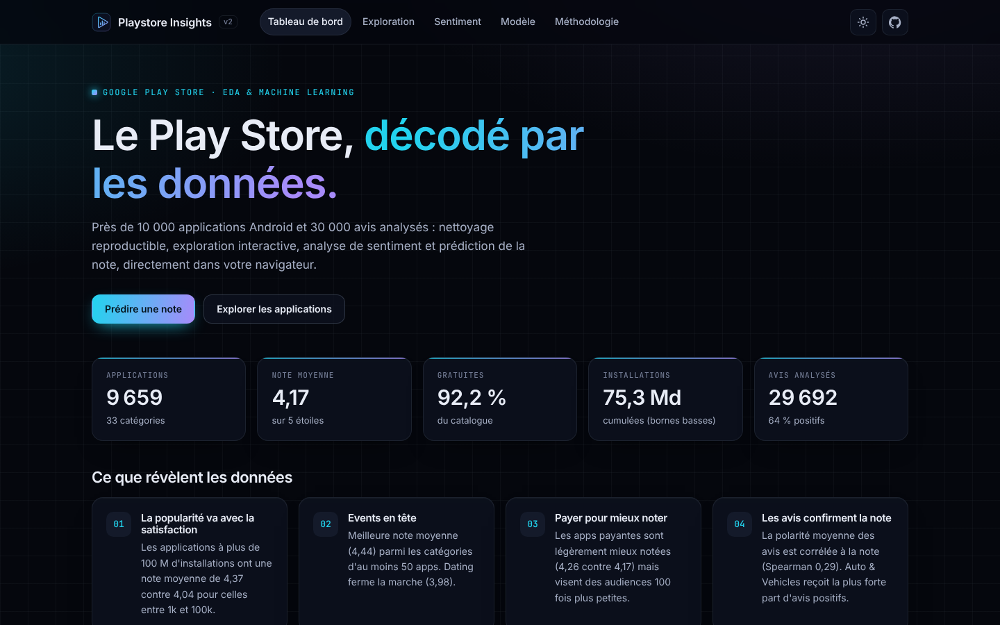
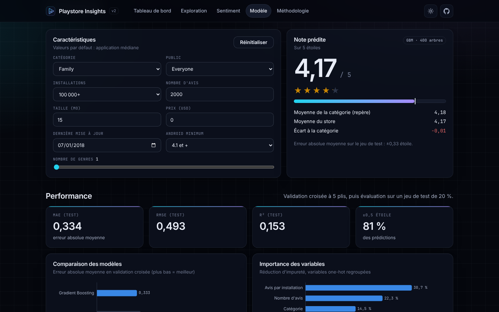
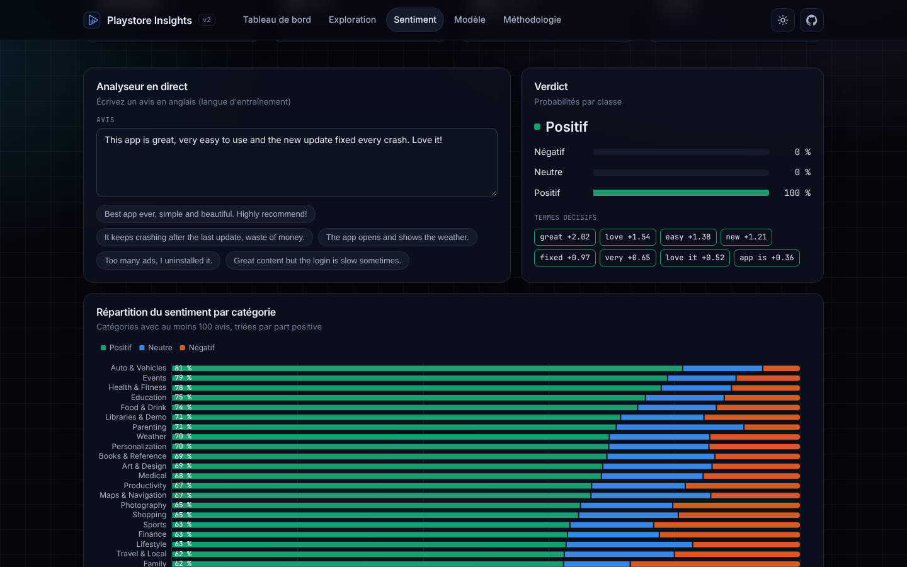
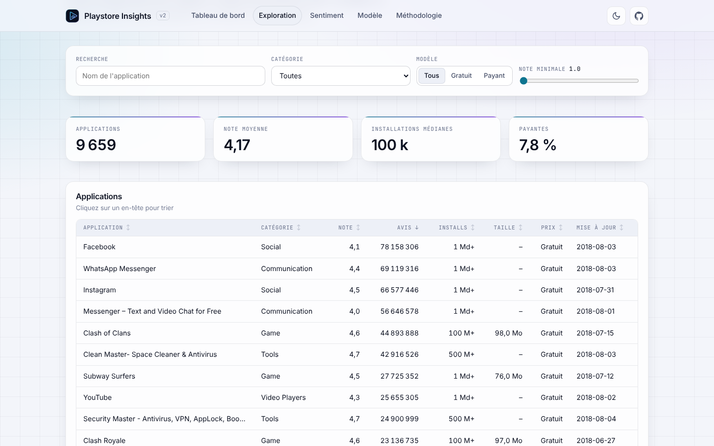
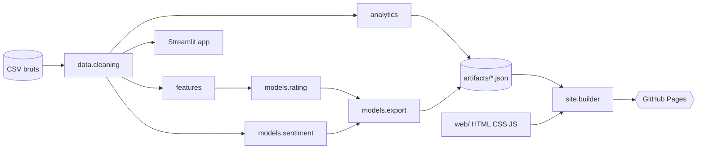

<div align="center">


# Playstore Insights

**Analyse exploratoire, machine learning et tableau de bord interactif du Google Play Store.**

10 841 applications et 64 295 avis, nettoyés de façon reproductible, explorés, modélisés puis publiés sur GitHub Pages avec des modèles exécutés directement dans le navigateur.

[](https://github.com/Aziguy/DataScienceEDA/actions/workflows/ci.yml)
[](https://aziguy.github.io/DataScienceEDA/)
[](https://github.com/Aziguy/DataScienceEDA/actions/workflows/pages.yml)
[](https://aziguy.github.io/DataScienceEDA/model.html)
[](https://aziguy.github.io/DataScienceEDA/sentiment.html)
[](LICENSE)


[**Tableau de bord en ligne**](https://aziguy.github.io/DataScienceEDA/) ·
[Prédire une note](https://aziguy.github.io/DataScienceEDA/model.html) ·
[Analyser un avis](https://aziguy.github.io/DataScienceEDA/sentiment.html) ·
[Signaler un bug](https://github.com/Aziguy/DataScienceEDA/issues/new?template=bug_report.yml)

</div>



## Sommaire

- [Fonctionnalités](#fonctionnalités)
- [Résultats](#résultats)
- [Aperçu](#aperçu)
- [Architecture](#architecture)
- [Démarrage rapide](#démarrage-rapide)
- [Commandes](#commandes)
- [Déploiement](#déploiement)
- [Feuille de route](#feuille-de-route)
- [Contribuer](#contribuer)
- [Équipe](#équipe)
- [Licence](#licence)

## Fonctionnalités

| Module | Description |
|---|---|
| **Nettoyage reproductible** | Parsing typé des tailles (`k`, `M`, `G`), installations, prix, dates et versions Android. Ligne corrompue écartée, doublons supprimés, rapport de qualité généré à chaque build. |
| **Tableau de bord statique** | Site GitHub Pages sans serveur : KPI, insights calculés, 20+ graphiques interactifs, thème clair et sombre, responsive. |
| **Exploration** | Filtres croisés (recherche, catégorie, gratuit / payant, note), tableau triable et paginé de 9 659 apps, nuage de points, corrélations de Spearman. |
| **Prédiction de note** | Gradient boosting de 400 arbres exporté en JSON et évalué en JavaScript, parité avec scikit-learn vérifiée à 1e-9. |
| **Analyse de sentiment** | TF-IDF (unigrammes et bigrammes) et régression logistique, analyseur d'avis en direct avec termes décisifs. Aucun texte ne quitte le navigateur. |
| **Application Streamlit** | Version multipage pour l'analyse interactive, avec un outil de profilage de n'importe quel CSV. |
| **Qualité** | Tests unitaires, tests de parité Python / JavaScript, tests de rendu Streamlit, 99 % de couverture, lint Ruff, CI sur Python 3.10 à 3.13. |

## Résultats

### Prédiction de la note

Validation croisée à 5 plis sur 8 196 applications notées, 45 variables.

| Modèle | MAE | RMSE | R² |
|---|---:|---:|---:|
| **Gradient Boosting (retenu)** | **0.333** | **0.488** | **0.170** |
| Random Forest | 0.336 | 0.489 | 0.166 |
| Ridge | 0.342 | 0.495 | 0.147 |
| Baseline (moyenne) | 0.381 | 0.536 | 0.000 |
| KNN v1 (modèle d'origine) | 0.395 | 0.569 | -0.128 |

Sur le jeu de test, **81 % des prédictions tombent à ±0.5 étoile** de la note réelle. Le R² reste modeste : la note dépend surtout de la qualité perçue, absente des métadonnées. Le modèle capte des tendances (engagement, fraîcheur, catégorie), pas un verdict.

### Analyse de sentiment

| Métrique | Valeur |
|---|---:|
| Accuracy | 0.902 |
| F1 macro | 0.872 |
| Avis d'entraînement | 23 753 |
| Vocabulaire | 8 000 termes |

### Ce que révèlent les données

- Les applications à plus de **100 M d'installations** sont les mieux notées (4.37 en moyenne).
- Les apps **payantes** sont mieux notées (4.26 contre 4.17) mais visent des audiences 100 fois plus petites.
- Le **ratio avis / installations** est la variable la plus prédictive de la note.
- La polarité moyenne des avis est corrélée à la note (Spearman 0.29).

## Aperçu

| Prédiction en direct | Analyse de sentiment |
|---|---|
|  |  |



## Architecture



```text
.
├── app/                      Application Streamlit multipage
│   ├── components.py         Cache, thème Plotly, helpers UI
│   └── views/                Vue d'ensemble, exploration, sentiment, prédiction, profilage
├── data/raw/                 Jeux de données d'origine (Kaggle, août 2018)
├── src/playstore_insights/
│   ├── data/                 Chargement et nettoyage typé
│   ├── models/               Notation, sentiment, export JSON portable
│   ├── site/                 Génération du site statique et des badges
│   ├── analytics.py          Agrégations du tableau de bord
│   ├── features.py           Spécification des variables partagée Python / JS
│   ├── pipeline.py           Orchestration et persistance des artefacts
│   └── cli.py                Point d'entrée `playstore-insights`
├── web/                      Sources du site (HTML, CSS, modules ES)
│   └── assets/js/lib/        Runtime d'inférence, graphiques, composants
├── tests/                    pytest + parité Node.js
└── .github/workflows/        CI et déploiement Pages
```

Le principe clé : **une seule spécification de variables** (`features.py`) est exportée avec le modèle. Le runtime JavaScript (`web/assets/js/lib/features.js`, `models.js`) la rejoue à l'identique, et `tests/test_js_parity.py` garantit que Python et le navigateur produisent les mêmes prédictions.

## Démarrage rapide

Prérequis : Python 3.10+, Node.js 18+ (uniquement pour les tests de parité).

```bash
git clone https://github.com/Aziguy/DataScienceEDA.git
```

```bash
cd DataScienceEDA
```

```bash
python -m venv .venv && source .venv/bin/activate
```

```bash
make install
```

Générer le site et le servir sur http://localhost:8000 :

```bash
make serve
```

Lancer l'application Streamlit sur http://localhost:8501 :

```bash
make app
```

Ou avec Docker :

```bash
make docker
```

## Commandes

| Commande | Effet |
|---|---|
| `make install` | Installe le package en mode éditable avec les extras `dev` et `app`, active pre-commit |
| `make lint` | Ruff (lint et format) |
| `make format` | Corrige et formate le code |
| `make test` | pytest avec couverture |
| `make train` | Nettoie, compare les modèles, entraîne et écrit `artifacts/` |
| `make site` | Pipeline complet puis génération de `build/site/` |
| `make serve` | Génère et sert le site localement |
| `make app` | Lance l'application Streamlit |
| `make docker` | Construit et lance l'image Docker |

La CLI est aussi disponible directement : `playstore-insights {train,site,all} [--fast] [--coverage 99]`.

## Déploiement

**GitHub Pages.** Le workflow `pages.yml` teste, entraîne, génère le site et le déploie à chaque push sur `master`. Activation unique : *Settings > Pages > Build and deployment > Source : GitHub Actions*. Les badges de couverture et de performance sont publiés avec le site (`/badges/*.json`) et lus par shields.io.

**Streamlit Community Cloud.** Pointer l'application sur `app/streamlit_app.py`. Le fichier `requirements.txt` installe le package avec l'extra `app`.

**Docker.** L'image entraîne les modèles au build et expose Streamlit sur le port 8501.

## Feuille de route

- [ ] Prédiction du palier d'installations (classification)
- [ ] Explications locales des prédictions (contributions SHAP exportées)
- [ ] Analyse de sentiment multilingue
- [ ] Mise à jour du jeu de données avec une collecte récente
- [ ] Mode hors ligne (PWA) pour le tableau de bord

Les idées et retours sont les bienvenus dans les [issues](https://github.com/Aziguy/DataScienceEDA/issues).

## Contribuer

Les contributions sont les bienvenues. Consultez le [guide de contribution](CONTRIBUTING.md) et le [code de conduite](CODE_OF_CONDUCT.md). En résumé :

1. Forkez le dépôt et créez une branche (`feat/ma-fonctionnalite`).
2. `make install`, puis développez avec des tests.
3. Vérifiez `make lint test`.
4. Ouvrez une pull request en suivant le modèle.

Pour signaler une vulnérabilité, suivez la [politique de sécurité](SECURITY.md).

## Équipe

Team data analytics, data scientists en devenir.

| | |
|---|---|
| Esteban Bara | [LinkedIn](https://www.linkedin.com/in/esteban-bara/) |
| Gervais Kituanga | [LinkedIn](https://www.linkedin.com/in/gervais-kituanga-mitimiti/) |
| Thomas Touil | [LinkedIn](https://www.linkedin.com/in/thomas-touil-b168a5144/) |
| Abdou Aziz Ziza | |
| Hippolyte Kengni | [GitHub](https://github.com/Aziguy) |

## Licence

Distribué sous licence [MIT](LICENSE). Le jeu de données [Google Play Store Apps](https://www.kaggle.com/datasets/lava18/google-play-store-apps) est publié sur Kaggle par Lavanya Gupta et reste soumis à ses propres conditions.
